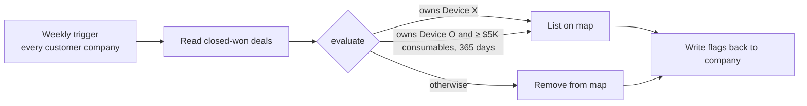

# CRM Automation Toolkit

Production-style CRM automations from my work running revenue systems for a medical device + consumables company: a HubSpot custom-code workflow, an AI email triage agent for accounts receivable, and an AI assistant that answers CRM questions in plain language.

> **About this repo.** These are clean-room versions of automations I built and run in production. All data, IDs, names and property values are synthetic. The logic and design choices are real.

| Folder | What it is | Stack | Impact |
|---|---|---|---|
| [`provider-map/`](provider-map/) | Weekly HubSpot workflow that decides which practices appear on the public "find a provider" map | HubSpot custom code (Node), CRM API | Map stays accurate with zero manual updates |
| [`ar-email-triage/`](ar-email-triage/) | Agent that reads AR emails, classifies them, logs one case per issue and notifies the owner | Copilot Studio, Power Automate, SharePoint (logic in Python) | One case per issue; no lost customer emails |
| [`docs/crm-ai-assistant.md`](docs/crm-ai-assistant.md) | Plain-language assistant on live CRM data | HubSpot Breeze AI | Request turnaround **hours → under 10 min** |

## 1. Provider Map workflow



All logic sits in one pure function, `evaluate()`, so it is unit-tested outside HubSpot. `exports.main` is a thin wrapper that reads deals and writes the flags. Returns net out of the consumables total, and orders older than 365 days drop off on their own.

```bash
node --test provider-map/providerMap.test.js   # 5 tests
```

## 2. AR email triage agent

Classifies each email (dispute, remittance, credit, W-9, statement, financing, collections), pulls out invoice numbers and amounts, and **upserts** a case: a reply on the same thread, or a new thread about the same invoice, updates the existing case instead of opening a new one. Priority only goes up. Anything unclear goes to a human.

```bash
cd ar-email-triage && python -m pytest -q      # 5 tests
```

How it maps to the low-code build: [`docs/ar-triage-flow.md`](docs/ar-triage-flow.md).

## 3. Conversational CRM assistant

Case study: [`docs/crm-ai-assistant.md`](docs/crm-ai-assistant.md).

## Principles across all three

1. **Logic in testable code, wiring in the platform.** Workflows stay thin.
2. **Deterministic where it matters.** AI labels and extracts; matching and money math are rules.
3. **Write facts back to the CRM.** Flags like `consumables_net_last_365` get reused by reports, routing and the AI assistant.
4. **A human sees anything unclear.**

---
Built by [Vrutik Adani](https://www.linkedin.com/in/vrutikadani) · GTM Systems & AI Engineering
