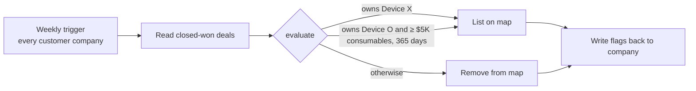

# CRM Automation Toolkit

[](https://github.com/vrutikadani/crm-automation-toolkit/actions/workflows/ci.yml)

Reference CRM automations: a HubSpot custom-code workflow, a rule-based email triage for accounts receivable, and a design note for a plain-language CRM assistant.

> **About this repo.** Clean-room reference implementation using synthetic data, inspired by workflows I built at work. Not employer source code; no production metrics. All data, IDs, names and property values are made up.

| Folder | What it is | Stack | What it shows |
|---|---|---|---|
| [`provider-map/`](provider-map/) | Weekly HubSpot workflow that decides which practices appear on a public "find a provider" map | HubSpot custom code (Node), CRM API | Eligibility as one pure, tested function |
| [`ar-email-triage/`](ar-email-triage/) | Rule-based triage: regex keyword rules label AR emails, then one case is logged per issue and the owner is notified | Python reference logic; maps to Power Automate + SharePoint | Deterministic case matching by thread and invoice |
| [`docs/crm-ai-assistant.md`](docs/crm-ai-assistant.md) | Design note for a plain-language assistant on CRM data | HubSpot Breeze AI | No code in this repo |

## 1. Provider Map workflow



All logic sits in one pure function, `evaluate()`, so it is unit-tested outside HubSpot. `exports.main` is a thin wrapper that reads deals and writes the flags. Returns net out of the consumables total, and orders older than 365 days drop off on their own.

```bash
node --test provider-map/providerMap.test.js   # 5 tests
```

## 2. AR email triage (rule-based)

Regex keyword rules classify each email (dispute, remittance, credit, W-9, statement, financing, collections), regex pulls out invoice numbers and amounts, and **upserts** a case: a reply on the same thread, or a new thread about the same invoice, updates the existing case instead of opening a new one. Priority only goes up. Anything no rule matches goes to a human. Patterns use word boundaries, so `ach` does not match "attached" and `lease` does not match "please". No AI model is called.

```bash
cd ar-email-triage && python -m pytest -q      # 14 tests
```

How it could map to a low-code build: [`docs/ar-triage-flow.md`](docs/ar-triage-flow.md).

## 3. Conversational CRM assistant

Design note (no code): [`docs/crm-ai-assistant.md`](docs/crm-ai-assistant.md).

## Principles across all three

1. **Logic in testable code, wiring in the platform.** Workflows stay thin.
2. **Deterministic where it matters.** In this repo, labels, extraction, matching and money math are all rules. A low-code build could swap in an AI classifier for labels only.
3. **Write facts back to the CRM.** Flags like `consumables_net_last_365` can be reused by reports, routing and an assistant.
4. **A human sees anything unclear.**

