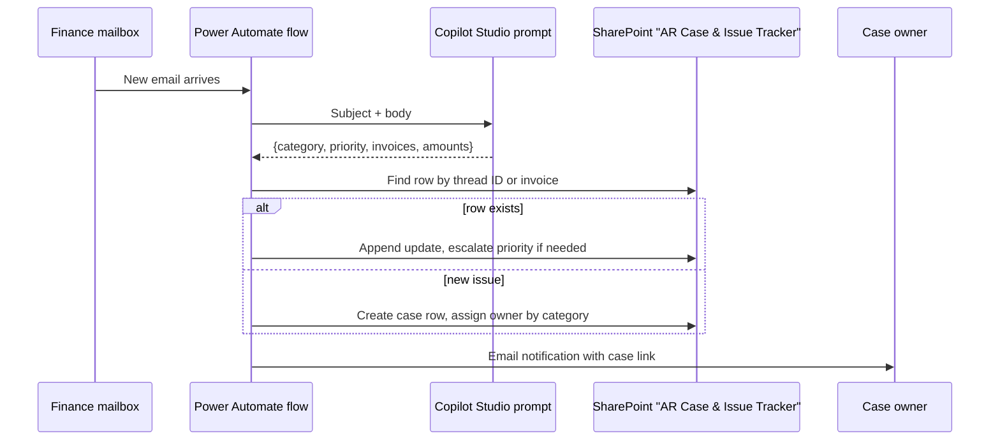

# AR Email Triage — Power Automate + Copilot Studio build

The tested logic lives in `ar-email-triage/triage.py`. This page shows how the same logic maps onto the low-code build that the finance team runs.

## SharePoint list columns

| Column | Type | Notes |
|---|---|---|
| Case ID | Text | `AR-0001` |
| Category | Choice | dispute, remittance, credit, W-9, statement, financing, collections, needs review |
| Priority | Choice | High / Normal / Low — only ever escalates |
| Owner | Person | Set from category |
| Customer email | Text | |
| Invoice numbers | Text | Comma-separated; used to link new threads to old cases |
| Thread ID | Text | Outlook conversation ID; replies update the same row |
| Status | Choice | Open / Waiting on customer / Resolved |
| History | Multi-line | One line per email |

## Handoff approach

The finance lead owns and runs the flow in her own environment. I packaged it as an importable solution plus a step-by-step setup guide, and it was tested in a test environment before going live.

Design choices:

- **Classify, then look up.** The model only labels and extracts. Matching to an existing case is deterministic (thread ID, then invoice number), so the same email can't open two cases.
- **Priority only goes up.** A reply saying "past due" escalates a case; a polite follow-up never downgrades it.
- **Unknown goes to a human.** Anything the classifier can't place goes to the finance lead's review queue.
