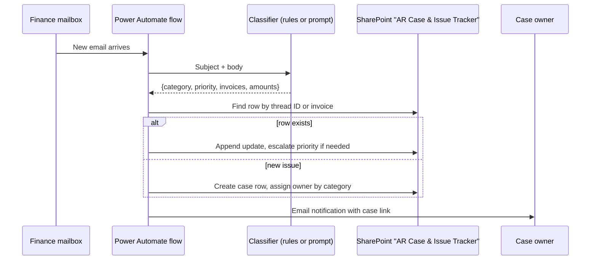

# AR Email Triage — how it could map to Power Automate

The tested logic lives in `ar-email-triage/triage.py`. It is rule-based: regex keyword patterns, no AI model. This page shows how the same logic could map onto a low-code build. In that build, the classifier step could be the same rules or a Copilot Studio prompt.

## SharePoint list columns

| Column | Type | Notes |
|---|---|---|
| Case ID | Text | `AR-0001` |
| Category | Choice | dispute, remittance, credit, W-9, statement, financing, collections, needs review |
| Priority | Choice | High / Normal / Low — only ever escalates |
| Owner | Person | Set from category |
| Customer email | Text | |
| Invoice numbers | Text | Comma-separated; used to link new threads to old cases |
| Thread ID | Text | Outlook conversation ID; replies update the same row |
| Status | Choice | Open / Waiting on customer / Resolved |
| History | Multi-line | One line per email |

## Design choices

- **Classify, then look up.** The classifier only labels and extracts. Matching to an existing case is deterministic (thread ID, then invoice number), so the same email can't open two cases.
- **Priority only goes up.** A reply saying "past due" escalates a case; a polite follow-up never downgrades it.
- **Unknown goes to a human.** Anything no rule matches goes to a review queue.
- **Whole words only.** Keyword patterns use word boundaries, so "attached" is not read as "ACH".
