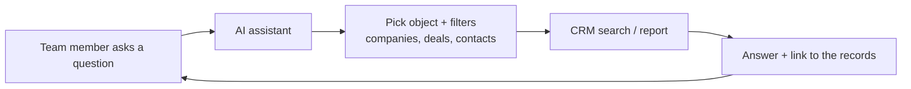

# Conversational CRM Assistant — design note

This is a design note. There is no code for it in this repo, and no production metrics.

**Problem.** Teams send many small data requests, such as "How many Device O customers in Texas bought consumables last quarter?" Each one waits in an analyst's queue.

**Idea.** An assistant on HubSpot's built-in AI (Breeze), wired into the CRM, so internal teams ask in plain language and get the answer from CRM data.

## How it is put together

## What would make it trustworthy

- **Clean properties first.** The assistant is only as good as the fields under it. The Provider Map flags (`has_device_x`, `has_device_o`, `consumables_net_last_365`) and standard territory names help questions like the one above have one right answer.
- **Show the records.** Every answer should link to the records it came from, so people can check it.
- **Know the edges.** Questions that need payout math or board numbers should still go to finance. The assistant should handle lookups, not sign-off numbers.
