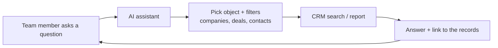

# Conversational CRM Assistant — case study

**Problem.** Sales, finance and leadership sent a steady stream of small data requests: "How many Device O customers in Texas bought consumables last quarter?" Each one waited in an analyst's queue for hours.

**What I built.** An AI assistant on HubSpot's built-in AI (Breeze), wired into the CRM, so internal teams ask in plain language and get the answer from live CRM data.

**Result.** Routine request turnaround went from **hours to under 10 minutes**.

## How it is put together

## What made it trustworthy

- **Clean properties first.** The assistant is only as good as the fields under it. The Provider Map flags (`has_device_x`, `has_device_o`, `consumables_net_last_365`) and standard territory names exist partly so questions like the one above have one right answer.
- **Show the records.** Every answer links to the records it came from, so people can check it.
- **Know the edges.** Questions that need payout math or board numbers still come to finance. The assistant handles lookups, not sign-off numbers.
